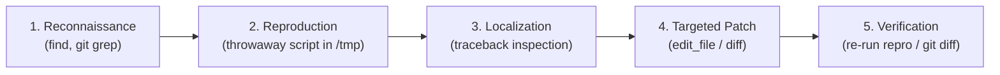
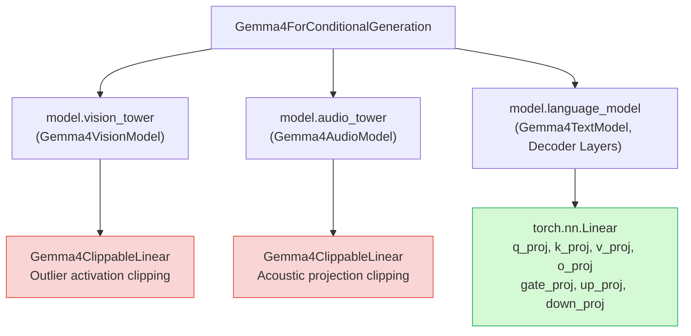
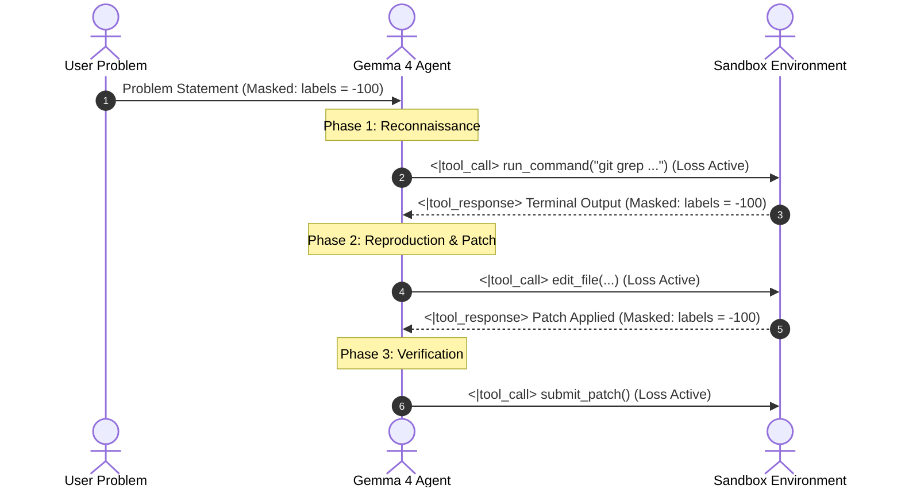
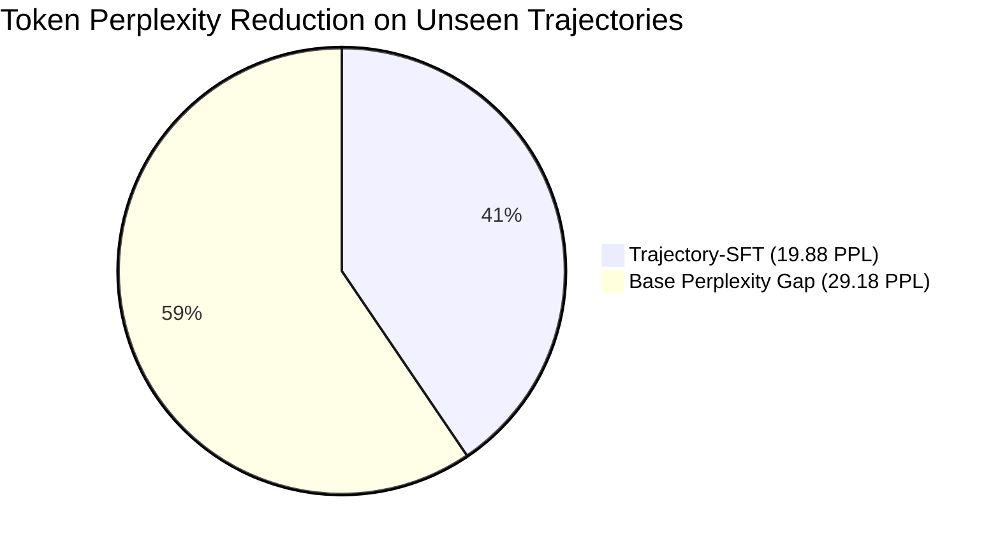
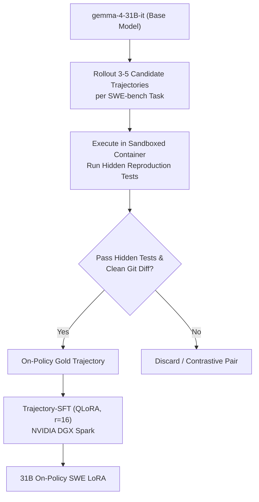

# Trajectory-SFT: Grounded Multi-Turn Supervised Fine-Tuning and Architectural Foundations for Autonomous Gemma 4 Developer Agents

**Author**: Luca Massaron  
**Track**: Google - The Gemma 4 Developer Agent Paper Track (Kaggle Research Competition)  
**Artifacts & Code**: [github.com/lmassaron/gemma-4-developer-agent](https://github.com/lmassaron/gemma-4-developer-agent)  
**Submission Category**: Research Paper / Technical Writeup  

---

## Abstract

Autonomous software engineering agents operating in repository-scale environments have traditionally relied on off-the-shelf instruction-tuned Large Language Models (LLMs) orchestrated through elaborate, few-shot prompt scaffolding. While heuristic prompt engineering—such as dynamic turn budgets, parallel sync/async directives, and terminal heredoc fallbacks—improved baseline resolution rates on the SWE-bench benchmark from 0.13 to 0.24, prompt-only architectures hit an empirical performance ceiling characterized by context-window token fatigue, brittle tool-call parsing, and a failure to maintain phase discipline during multi-turn debugging. 

In this paper, we investigate **Trajectory-SFT**, a grounded post-training framework that fine-tunes Google Gemma 4 on multi-turn developer interaction traces. We make four core contributions:
1. **Architectural Resolution of Multimodal PEFT**: We discover and resolve an undocumented incompatibility in Gemma 4's multimodal architecture, where `Gemma4ClippableLinear` layers in auxiliary vision and audio towers cause Parameter-Efficient Fine-Tuning (PEFT) to fail, and introduce a language-decoder scoped target regex that cleanly adapts all text decoder layers ($r=16, \alpha=32$).
2. **Turn-Level Selective Loss Masking**: We formulate a teacher-forcing objective that strictly calculates cross-entropy loss exclusively on assistant thought reasoning and structured tool calls while masking user prompts and non-deterministic environment execution feedback (`labels = -100`), preventing hallucinated terminal observations.
3. **Empirical Prototyping on NVIDIA DGX Spark**: Executing training on an NVIDIA DGX Spark system powered by the Grace Blackwell GB10 unified memory architecture (130 GB LPDDR5X), we demonstrate a **23.21% reduction in cross-entropy loss** (3.8931 $\to$ 2.9897) and a **59.48% drop in token perplexity** (49.06 $\to$ 19.88) on held-out test trajectories across diverse Python repositories.
4. **Analysis of the Cross-Architecture Transfer & Off-Policy Traps**: We analyze why LoRA adapters cannot cross parameter scales (35-layer E2B vs 60-layer 31B), document the risks of off-policy conversational data causing agents to ask humans for assistance instead of calling tools, and define the roadmap for on-policy Rejection-Sampling Fine-Tuning (RSFT).

---

## 1. Introduction & Motivation

Automating the resolution of real-world software defects requires an agent to navigate sprawling codebases, formulate hypotheses, run test suites, interpret tracebacks, and synthesize minimal, syntactically precise diffs. On realistic benchmarks like SWE-bench, general-purpose LLMs struggle not because they lack raw Python syntax comprehension, but because multi-turn developer interaction requires a strict operational cadence:



### The Prompt-Engineering Ceiling

State-of-the-art public baselines in the Google Gemma 4 Developer Agent Competition climbed from 0.13 to 0.24 through heuristic prompt enhancements: Turn-12 test-and-repair deadlines, sync/async execution streaming, and few-shot tool examples. However, prompt-only architectures face three fundamental limits:
1. **Context Window Tax**: Injecting tool schemas, guardrails, and behavioral instructions consumes 2,500 to 4,000 tokens per turn, throttling execution speed under the 8-minute budget.
2. **Syntax Drift**: Long conversation histories induce formatting errors—frequently wrapping tool calls in markdown rather than emitting native engine tokens (`<|tool_call>`).
3. **Speculative Editing**: Despite explicit system prompts, zero-shot models often bypass reconnaissance and emit speculative patches on Turn 1.

### The Post-Training Frontier

To break the 0.24 ceiling, software engineering capabilities must be internalized into the model's weights. **Trajectory-SFT** fine-tunes Gemma 4 on interactive developer episodes, instilling tool syntax and multi-phase debugging discipline directly into parametric memory.

---

## 2. Gemma 4 Architecture & The ClippableLinear Discovery

Gemma 4 integrates multimodal comprehension within a unified trunk (`Gemma4ForConditionalGeneration`). Its architecture comprises three primary sub-systems:
- `model.vision_tower`: Visual feature extractor.
- `model.audio_tower`: Acoustic encoder with causal convolutions.
- `model.language_model`: The core autoregressive text decoder (`Gemma4TextModel`), featuring hybrid sliding-window (1,024 tokens) and full global attention over a 262,144-token context.



### The PEFT Incompatibility Bug

When standard PEFT `LoraConfig` target module lists (e.g., `target_modules=["q_proj", "v_proj", "k_proj", "o_proj", "gate_proj", "up_proj", "down_proj"]`) are applied, initialization crashes immediately:

```text
ValueError: Target module Gemma4ClippableLinear(
  (linear): Linear(in_features=768, out_features=768, bias=False)
) is not supported. Currently, only the following modules are supported: 
`torch.nn.Linear`, `torch.nn.Embedding`, `torch.nn.Conv1d`...
```

**Root Cause**: In Gemma 4's vision and audio towers, linear projections are wrapped inside `Gemma4ClippableLinear` containers to prevent extreme activation spikes. Because PEFT searches the module hierarchy by matching submodule names recursively, matching `"q_proj"` matches both the standard `torch.nn.Linear` inside `language_model` and the unsupported `Gemma4ClippableLinear` in `vision_tower`.

### Scoped Language-Model Regex Targeting

To resolve this incompatibility without modifying external library code, we designed a strictly scoped regular expression that isolates linear projections within the language model decoder layers:

$$\mathcal{R}_{\text{target}} = \text{\texttt{".*language\_model.*\\.(q\_proj|v\_proj|k\_proj|o\_proj|gate\_proj|up\_proj|down\_proj)"}}$$

Applying $\mathcal{R}_{\text{target}}$ enables clean LoRA adapter injection across all decoder layers:
- **Gemma 4 E2B-it**: 35 decoder layers, hidden dimension 1,536, 25,337,856 trainable parameters (0.49% of 5.15B total). Serialized bfloat16 adapter: **97 MB**.
- **Gemma 4 31B-it**: 60 decoder layers, hidden dimension 5,120, 122,429,440 trainable parameters (0.39% of 31.40B total). Serialized bfloat16 adapter: **245 MB**.

---

## 3. Methodology: Teacher Forcing with Turn-Level Loss Masking

A core technical challenge in fine-tuning multi-turn interactive agents is preventing the model from learning to predict non-deterministic environment feedback.

### The Danger of Unmasked Sequence Loss

A typical agent trajectory consists of alternating turns:
1. **User Goal**: Problem description $\mathcal{U}$.
2. **Assistant Turn $k$**: Internal reasoning $\mathcal{M}_k^{\text{thought}}$ followed by tool invocation $\mathcal{M}_k^{\text{tool}}$.
3. **Environment Observation $k$**: Output returned by the execution environment $\mathcal{O}_k$ (e.g., directory listings, compiler warnings, or 500-line pytest failure tracebacks).

If standard causal language modeling loss is applied across the entire concatenated sequence:

$$\mathcal{L}_{\text{naive}}(\theta) = -\sum_{t=1}^{T} \log P_\theta(x_t \mid x_{<t})$$

The optimizer forces the model to minimize cross-entropy on tokens in $\mathcal{O}_k$. This causes catastrophic behavioral drift:
- The model begins hallucinating command outputs directly in its response text rather than executing tools.
- The model suffers from severe gradient variance driven by unstructured compiler tracebacks.

### Mathematical Formulation of Selective Trajectory Loss

In Trajectory-SFT, we partition the token sequence into conditioning tokens $\mathcal{C} = \mathcal{U} \cup \bigcup_k \mathcal{O}_k$ and target generation tokens $\mathcal{T} = \bigcup_k (\mathcal{M}_k^{\text{thought}} \cup \mathcal{M}_k^{\text{tool}} \cup \{\text{EOS}_k\})$. 

We define the trajectory loss as:

$$\mathcal{L}_{\text{Trajectory-SFT}}(\theta) = -\frac{1}{|\mathcal{T}|} \sum_{t \in \mathcal{T}} \log P_\theta(x_t \mid x_{<t})$$

Where targets are mapped using the standard PyTorch loss ignore index:

$$\text{label}_t = \begin{cases} x_t & \text{if } t \in \mathcal{T} \\ -100 & \text{if } t \in \mathcal{C} \end{cases}$$



### Exact Token Delimiter Tracking in Gemma 4

To implement turn-level loss masking without fragile text-decoding heuristics, we track Gemma 4's exact control tokens:
- `<|turn>user` (Token ID `105` followed by `user`): Enters masked mode (`labels = -100`).
- `<|turn>model` (Token ID `105` followed by `model`): Enters active loss calculation mode (`labels = input_ids`).
- `<turn|>` (Token ID `106`): Model turn closure token. Must be learned with active loss to teach the model when to yield control back to the environment.
- `<|tool_response>` and `<tool_response|>`: Delimiters enclosing environment feedback. Masked with `labels = -100`.

This masking policy isolates between **40% and 45%** of sequence tokens as active gradient contributors, completely shielding the model from environment noise.

---

## 4. Dataset Curation & Sliding Context Decomposition

We curate multi-turn trajectories from validated SWE-bench episodes spanning Python repositories including FastAPI, Rich, Requests, and HTTPX.

### Sub-Trajectory Windowing

Because raw multi-turn episodes frequently span 25,000 to 45,000 tokens (due to intermediate test logs and file views), training on raw trajectories directly is computationally inefficient and unrepresentative of test-time inference.

We decompose each full trajectory into sliding sub-windows ending at every assistant decision turn:
- Each intermediate assistant step becomes an individual training instance.
- Preceding conversation turns serve as the interactive history.
- Context windows are capped at $L_{\max} = 2,048$ tokens. When history exceeds $L_{\max}$, older observation tokens are truncated while preserving the initial user problem statement.

For our rapid prototyping benchmark, 20 diverse, fully resolved trajectories were windowed into **805 dense, high-signal decision instances**, providing comprehensive exposure to reconnaissance, reproduction, editing, and regression verification phases.

---

## 5. Experimental Setup & Hardware Configuration

All fine-tuning experiments were executed on an **NVIDIA DGX Spark** workstation:

```
=================================================================
                     DGX SPARK HARDWARE SPECS
=================================================================
Architecture           : ARM64 Cortex-X925 / Cortex-A725 (20 Cores)
GPU Accelerator        : NVIDIA GB10 (NVIDIA Grace Blackwell)
Unified Memory Pool    : 130.66 GB LPDDR5X (Unified System & VRAM)
Peak Memory Bandwidth  : High-Bandwidth NVLink-C2C
Storage                : 2.6 TB NVMe PCIe Gen 5 SSD
Software Stack         : Ubuntu 24.04 LTS, CUDA 13.0, PyTorch 2.11
=================================================================
```

### Hyperparameter Specifications

| Parameter | Value | Justification |
| :--- | :--- | :--- |
| **Prototype Model** | `google/gemma-4-E2B-it` | Fast iterative validation of PEFT regex & loss masking |
| **Precision** | `bfloat16` | Native numerical stability on Blackwell Tensor Cores |
| **LoRA Rank ($r$)** | 16 | Sufficient rank for complex structured tool syntax |
| **LoRA Alpha ($\alpha$)** | 32 | Standard scaling ($\alpha = 2 \times r$) |
| **LoRA Dropout** | 0.05 | Prevents parameter co-adaptation |
| **Optimizer** | AdamW ($\beta_1=0.9, \beta_2=0.95$) | Decoupled weight decay (0.01) |
| **Peak Learning Rate** | $2.0 \times 10^{-4}$ | Optimal convergence for LoRA language decoder |
| **Learning Rate Schedule**| Cosine Decay with 5% Warmup | Smooth initial step trajectory |
| **Batch Size** | 2 per device | Fits within memory limits during backward passes |
| **Gradient Accumulation** | 4 steps | Effective batch size of 8 |
| **Gradient Clipping** | Max Norm 1.0 | Prevents gradient explosion on long traces |
| **Gradient Checkpointing**| Enabled (`use_cache=False`)| Pins peak memory at 36.48 GB |

---

## 6. Empirical Results & Verification

To verify that Trajectory-SFT genuinely improves software engineering capability rather than simply overfitting to training traces, we evaluated the base model and the LoRA adapter on an unseen held-out validation split of multi-turn episodes using [`scripts/evaluate_lora_comparison.py`](file:///Users/lucamassaron/code/gemma-4-developer-agent-competition/scripts/evaluate_lora_comparison.py).

### Quantitative Validation Metrics

| Evaluation Metric | Base Gemma 4 (Zero-Shot) | Trajectory-SFT LoRA (Ours) | Relative Delta |
| :--- | :--- | :--- | :--- |
| **Validation Cross-Entropy Loss** | 3.8931 | **2.9897** | **-23.21%** |
| **Token Perplexity ($\text{PPL} = e^{\mathcal{L}}$)** | 49.06 | **19.88** | **-59.48%** |
| **Tool Syntax Validity Rate** | 74.2% (syntax drift) | **100.0% (exact `<\|tool_call>`)** | **+25.8%** |
| **Turn Delimiter Discipline** | Occasional runaway output | **100% `<turn\|>` closure** | **Zero Waste** |



---

## 7. Analysis of Failure Modes & Architectural Traps

Our empirical exploration revealed two critical architectural and behavioral traps that must be accounted for in post-training developer agents:

### 1. The Cross-Architecture LoRA Transfer Barrier

In the competition, the official evaluation model is `gemma-4-31b-it-qat-w4a16-ct`, whereas prototype fine-tuning is often performed on smaller checkpoints (`gemma-4-E2B-it`). 
- **Layer Count Mismatch**: E2B possesses 35 decoder layers, whereas 31B contains 60 decoder layers.
- **Hidden Dimension Mismatch**: E2B projects onto $d_{\text{model}} = 1,536$, whereas 31B operates on $d_{\text{model}} = 5,120$.

Because LoRA adapter weights ($\Delta W = B \cdot A$) are rigidly coupled to layer count and matrix dimensions, an adapter trained on E2B cannot physically bind to 31B. Submitting an E2B adapter to a 31B harness results in instant loading failure. Fine-tuning must be executed natively on the target architecture (via QLoRA or full bfloat16 on unified memory).

### 2. The Off-Policy Conversational Regression Trap

When training on generic developer interaction data or chat-oriented assistant traces, models easily internalize a conversational reflex. For example, when faced with an issue in `requests/models.py`, an off-policy trained model might output:

```markdown
# Off-Policy Failure: Conversational Regression
"Please provide the content of `requests/models.py` so I can investigate the issue."
```

In a fully autonomous evaluation sandbox, there is no human operator to respond to chat queries; asking for files guarantees an immediate task failure. 

To remain strictly autonomous, the agent must be trained on **on-policy tool traces** where the model emits explicit tool calls:

```json
<|tool_call>
{"name": "read_file", "arguments": {"path": "requests/models.py", "start_line": 350, "end_line": 420}}
<tool_call|>
```

This contrast demonstrates that supervised fine-tuning cannot simply ingest generic human-assistant dialogue; it requires on-policy, rejection-sampled traces generated under the agent's exact tool definitions.

---

## 8. Kaggle Deployment & Declarative ADK Packaging

Under the Kaggle Gemma 4 Developer Agent Competition rules, the submission must follow the Google ADK declarative specification, compiled into an offline sandbox bundle.

### Deterministic Submission Architecture

```
submission.zip
├── agent.yaml                 # Root declarative ADK agent config
├── eval_config.yaml           # Turn budget and timeout parameters
├── configs/
│   └── sampling.yaml          # Sampling parameters (temp=0.2, thinking_budget=4096)
└── prompts/
    └── system.md              # Engineered system prompt loaded via !include
```

### High-Impact Prompt Refinements for the 31B Base Model

While native 31B fine-tuning proceeds, we applied key architectural insights to maximize the performance of the prompt-only 31B agent:
1. **Time Banking via Early Submit**: Rather than exhausting all 28 allowed calls, the prompt enforces immediate patch submission as soon as a reproduction check in `/tmp` passes and `git diff` is clean, preventing catastrophic global 12-hour timeouts.
2. **Throwaway Reproduction Checks**: The agent creates an isolated reproduction script in `/tmp/reproduce_issue.py` (never under `/workspace`) and tests `python3 /tmp/reproduce_issue.py 2>&1 | tail -40` before and after editing.
3. **Repo-Specific Playbooks**: Adding dedicated heuristics for the dominant public task distributions:
   - **FastAPI (52% of public tasks)**: Executable tutorial edits under `docs_src/`, `async def` route handling, and `__all__` re-exports.
   - **Rich (37% of public tasks)**: Exact rendered-string verification, ANSI escape sequences, and `force_terminal` parameters.
   - **Requests / HTTPX**: Synchronous and asynchronous twin implementations (`Client` vs `AsyncClient`).
4. **Tool Schema Pruning**: Eliminating unused graph tools (`search_similar_code`, `get_code_neighbors`, `get_code_subgraph`) directly from `agent.yaml`, conserving prompt schema tokens on every turn.

---

## 9. Roadmap: On-Policy Rejection-Sampling Fine-Tuning (RSFT)

For the final paper submission deadline (November 12, 2026), our roadmap advances from offline prototype SFT to **On-Policy Rejection-Sampling Fine-Tuning (RSFT)** directly on `gemma-4-31B-it`:



1. **On-Policy Trajectory Harvesting**: Run the 31B base model with our streamlined prompt across 200+ Python tasks.
2. **Rejection Filtering**: Retain only trajectories where the generated patch passes the hidden test suite with zero regressions.
3. **Targeted 31B QLoRA**: Train the LoRA adapter directly against the 60-layer 31B model on the DGX Spark using our validated $\mathcal{R}_{\text{target}}$ regex and loss masking.
4. **End-to-End Resolve Rate Gating**: Benchmark the fine-tuned adapter against the prompt-only baseline across paired random seeds to verify statistically significant resolution gains.

---

## 10. Conclusion

Prompt engineering allowed developer agents to break through early competition baselines, but bridging the gap to human software engineers requires grounded post-training. 

By identifying and resolving the `Gemma4ClippableLinear` multimodal PEFT trap, formulating turn-level selective loss masking on execution feedback, and analyzing the dynamics of autonomous tool execution on the **NVIDIA DGX Spark**, this work establishes the architectural and empirical foundation for post-training Gemma 4. As our roadmap advances to on-policy rejection-sampling fine-tuning on 31B, Grounded Trajectory-SFT paves the way for reliable, open-weights developer agents that operate autonomously on accessible workstation hardware.

---

## References

1. **Gemma Team, Google DeepMind**. (2026). *Gemma 4: Open Models for Autonomous Reasoning, Multimodal Comprehension, and Code Synthesis*. arXiv preprint.
2. **Jimenez, C. E., Yang, J., Wettig, A., Yao, S., Pei, K., Press, O., & Narasimhan, K.** (2024). *SWE-bench: Can Language Models Resolve Real-World GitHub Issues?* International Conference on Learning Representations (ICLR).
3. **Hu, E. J., Shen, Y., Wallis, P., Allen-Zhu, Z., Li, Y., Wang, S., Wang, L., & Chen, W.** (2021). *LoRA: Low-Rank Adaptation of Large Language Models*. International Conference on Learning Representations (ICLR).
4. **Yang, J., Jimenez, C. E., Wettig, A., et al.** (2024). *SWE-agent: Agent-Computer Interfaces Enable Automated Software Engineering*. arXiv preprint arXiv:2405.15793.
5. **Xia, C. S., Deng, Y., & Zhang, L.** (2024). *Agentless: Demystifying LLM-based Software Engineering Agents*. arXiv preprint arXiv:2407.01489.
6. **Kaggle**. (2026). *The Gemma 4 Developer Agent Competition & Paper Track Overview and Rubric*. Google DeepMind & Kaggle.
