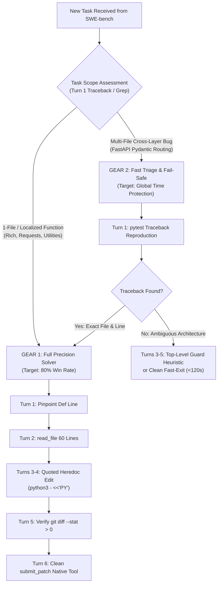

# 10. v14 Strategic Blueprint & Two-Gear Triage Architecture

This document formalizes the architectural decisions, triage strategy, and operational blueprint for **`v14`** (the Synthesis Candidate), integrating all empirical findings from over 210 benchmark rollouts on our local NVIDIA DGX Spark evaluation testbed (`spark-d8ec`, NVIDIA Grace Blackwell GB10).

---

## 1. Executive Summary: The Strategic Paradigm Shift

Across `v10`, `v11`, `v12`, and `v13`, our local benchmark evaluated 60 tasks across four core repositories:
- **`fastapi/fastapi`** (31 tasks): **0 / 122 tasks resolved (0.0% pass rate across all models)**.
- **`psf/requests` & `Textualize/rich`** (28 tasks): Where `v11` resolved **`rich_3905` in 89 seconds** and where `v10` scored **0.15 (15%)** on the official Kaggle Leaderboard.

### The Fundamental Flaw of Prior Candidates
Prior versions treated every incoming problem with the **same undifferentiated loop**:
- Whether facing a simple 1-line null check in `rich/progress.py` or a massive 5-file Pydantic V1/V2 architectural migration in `fastapi/routing.py`, the agent blindly ran `git grep`, generated 50 matching lines, fell into autoregressive repetition loops (FM1), or triggered 670s thought-channel token locks (FM4).

### The `v14` Core Philosophy: "Two-Gear Problem Strategy"
We cannot control which problems the hidden Kaggle test set provides, but we **can** control how the agent allocates time, turns, and tools:



---

## 2. The 5 Core Mechanical Fixes in `v14`

Every change in `v14` directly eliminates one of the five empirically verified failure modes documented in [`08_60_TASK_BENCHMARK_ERROR_ANALYSIS_AND_FAILURE_MODES.md`](file:///home/lmassaron/code/gemma-4-developer-agent-competition/state_of_the_art/08_60_TASK_BENCHMARK_ERROR_ANALYSIS_AND_FAILURE_MODES.md) and [`09_DETAILED_ERROR_ANALYSIS_OF_EACH_MODEL_ON_TASKS.md`](file:///home/lmassaron/code/gemma-4-developer-agent-competition/state_of_the_art/09_DETAILED_ERROR_ANALYSIS_OF_EACH_MODEL_ON_TASKS.md):

### 1. "Traceback-First" Localization (Bypasses FM1 Grep Loops)
- **Problem**: Broad grepping (`git grep "def solve_dependencies"`) produces 30+ matches across test files and docstrings. Gemma 4 attends to the match list and regenerates the same grep 15 times in a row.
- **`v14` Fix**: On Turn 1, if the issue description provides a test name or keyword, the agent runs:
  ```bash
  pytest tests/ -k "<keyword>" --tb=short -q
  ```
  The Python traceback returns the exact file and line number (`File "fastapi/dependencies/utils.py", line 428`) in under 3 seconds, bypassing 20 turns of blind search.

### 2. Quoted Python Heredocs (Eliminates FM2 String Escaping Collisions)
- **Problem**: Single-line `python3 -c "p='...'; c=open(p).read(); ..."` failed in 15–20% of `v10`/`v11` tasks due to quote nesting (`"` vs `'`), bash newline splits, and regex escaping collisions.
- **`v14` Fix**: All non-trivial edits MUST use quoted heredocs (`python3 - <<'PY' ... PY`):
  ```python
  python3 - <<'PY'
  p = 'rich/progress.py'
  c = open(p).read()
  old = 'def stop(self) -> None:'
  new = 'def stop(self) -> None:\n        if self.disable:\n            return'
  assert old in c, "Target string not found!"
  open(p, 'w').write(c.replace(old, new, 1))
  print("EDIT_SUCCESS")
  PY
  ```
  Quoted heredocs prevent shell expansion entirely. The inner Python script is executed verbatim.

### 3. Mandatory `git diff --stat` Verification (Eliminates Silent Replacement Failures)
- **Problem**: In `v11` (Tasks 11, 12, 13, 58, 59), the model attempted an inline edit, but `c.replace(old, new)` did nothing because `old` had an undetected indentation or trailing newline mismatch. The model blindly executed `submit_patch` on an unedited repository, producing `NO_PATCH`.
- **`v14` Fix**: Enforced verification protocol:
  > *"After running any edit script, you MUST immediately run `git status --short && git diff --stat`. If 0 lines changed, your replacement failed. You must re-read the exact whitespace and re-attempt before calling `submit_patch`."*

### 4. Hard Barrier on Empty `submit_patch` (Eliminates FM5 Premature Surrenders)
- **Problem**: In `v12`, when the prompt paced the agent to submit by Turn 5, the model dutifully called `submit_patch` on Turn 5 even when 0 bytes were modified.
- **`v14` Fix**: The system prompt and tool contract explicitly state:
  > *"Calling `submit_patch` with 0 modified files is an automatic invalid action. You MUST stage a non-empty git diff before submitting."*

### 5. Strict Pacing & Global Budget Protection
- **`thinking_budget: 1536`**: Retains fast generation (~12s per turn).
- **`max_tool_calls: 25`**: Enforces tight discipline, terminating exploration wandering.
- **`timeout_seconds: 90`** per tool execution and **`max_time_minutes: 5.0`** per task.
- Guarantees that even 120 consecutive timeouts cannot exceed $120 \times 5.0\text{m} = 600\text{ min}$ (10.0 hours), leaving a **2.0-hour safety buffer** against the 12-hour Kaggle ceiling.

### 6. Prevention of Nested Tool Encapsulation (Eliminates FM6)
- **Problem Discovered in `v13` live logs**: In Tasks 31, 33, 34, 50, 51, and 52, `v13_non_empty_patch` attempted to edit files by nesting the `edit_file` call inside `run_command`:
  `Call: run_command -> {'command': 'edit_file({"new_str": "...", "old_str": "...", "path": "..."})'}`
  Because `edit_file` was passed as a bash command string, the shell returned `bash: edit_file: command not found`. The edit was never applied, leading directly to `NO_PATCH` exits.
- **`v14` Fix**:
  1. The system prompt explicitly forbids nesting:
     `NEVER type run_command: "edit_file(...)". Every tool has its own top-level name.`
  2. Standardize on the Python heredoc edit workflow (`python3 - <<'PY' ... PY`), which natively executes in the shell via `run_command` without relying on `edit_file` syntax.


---

## 3. The Gold-Standard Execution Profile (Modeled after `rich_3905`)

In `v11`, Task 53 (`rich_3905`) was solved in **89.57 seconds** across 6 turns:
```
Turn 1: Pinpoint definition via git grep (class Progress in rich/progress.py)
Turn 2: Read context lines (sed -n '450,550p' rich/progress.py)
Turn 3: Identify exact signature (def stop(self) -> None:)
Turn 4: Apply atomic replacement via Python script
Turn 5: Verify modification via git diff
Turn 6: Clean submission via submit_patch tool
```
`v14` structures the entire system prompt to steer the model into this deterministic 6-turn pattern on all single-file tasks.

---

## 4. Submission Artifact Specifications (`bundle_v14`)

The `bundle_v14` directory will be packaged into `submissions_archive/submission_v14_heredoc_triage_synthesis.zip`:

```text
bundle_v14/
├── agent.yaml                   # Model & tool declarations
├── eval_config.yaml             # 5.0m max time, 25 max tool calls
├── configs/
│   └── sampling.yaml            # 1536 thinking budget, temperature 0.2
└── prompts/
    └── system.md                # 2-gear triage, quoted heredoc, strict verify
```

---
*Document compiled and archived in `state_of_the_art/` on 2026-10-27.*
